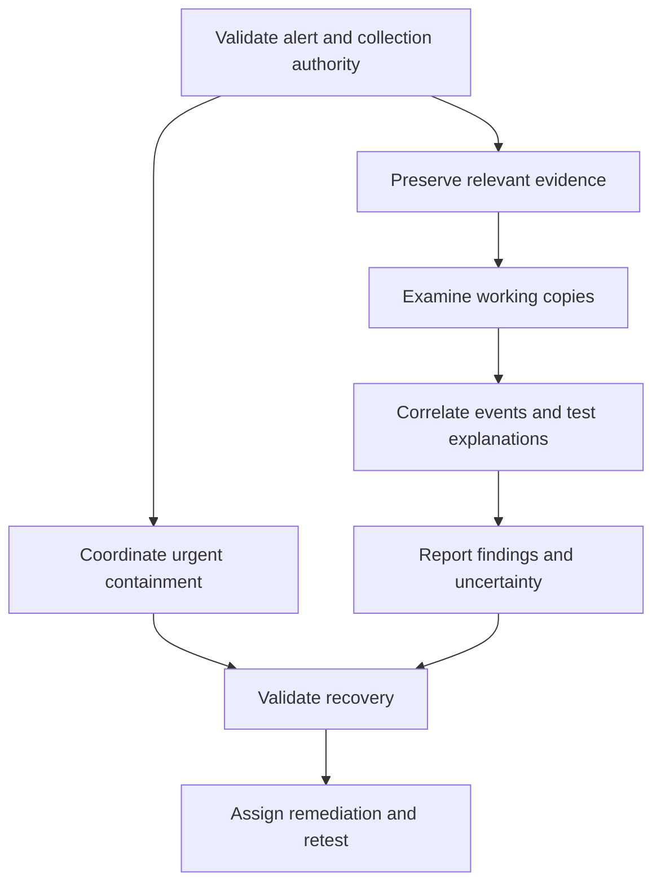

# Nexus Digital Forensics and Incident Response Case Study

An academic incident response design for a hypothetical gaming company, adapted from Tylan Knight's CS631 Digital Forensics final project at Colorado Technical University.

**Status: completed academic plan; no operational investigation or deployed security controls demonstrated.** The original report is dated October 4, 2026. This portfolio adaptation was prepared on October 20, 2026 with AI assistance in organization and editing. The templates are new portfolio materials derived from the plan.

## The problem

Nexus Interactive Entertainment needs a defensible way to investigate suspicious access to employee systems, development repositories and player services. The plan addresses evidence preservation, incident scope, containment and recovery while keeping unsupported conclusions visible.

## What this project contains

- [Scenario and scope](docs/scenario.md): the fictional environment and investigation questions.
- [Investigation workflow](docs/investigation-workflow.md): collection, examination, analysis, reporting and coordinated response.
- [Risk mitigation plan](docs/mitigation-plan.md): proposed ownership, deadlines and verification requirements.
- [Evidence register](templates/evidence-register.md), [chain of custody](templates/chain-of-custody.md) and [incident report](templates/incident-report.md): blank, editable templates.
- [Source mapping](docs/source-mapping.md): links between portfolio claims and the original assignment's pages.
- [References](docs/references.md): selected references recorded in the original assignment.
- [Synthetic incident exercise](lab/README.md): fictional logs, a guided analysis report, and an evidence-linked UTC timeline.

## Analytical approach

The design correlates identity, endpoint, application and network evidence to test competing explanations. It distinguishes an alert from confirmed execution, file creation from demonstrated transfer, and service disruption from data theft. Evidence handling includes identifiers, hashes, protected originals, working copies, custody records and time normalization.

Containment and preservation may proceed together. The sequence is not a reason to delay urgent action while waiting for complete acquisition.

## Demonstrated scope and limitations

The recovered assignment demonstrates a written investigation and mitigation design. It does not include disk or memory acquisitions, packet captures, real incident logs, named forensic-tool execution, SIEM deployment, measured response improvements or production recovery results. Company size and proposed deadlines are scenario assumptions. The new lab contains assistant-generated synthetic records, separate from the academic submission. Their structure and hashes have been checked. A guided discussion with Tylan is documented in the lab report; the assistant prepared the final report and timeline. No specific software is required to read this repository.

## How to review it

Read the scenario, follow the investigation workflow, and review the mitigation verification criteria. The templates can be copied into a future authorized exercise. Their empty fields must not be mistaken for evidence that an investigation occurred.

## Portfolio summary

Developed a digital forensics and incident response plan for a hypothetical gaming company, defining evidence preservation, chain of custody, log correlation, containment, and recovery procedures.

## Attribution

Academic source: Tylan Knight, *Digital Forensics and Incident Response Plan: Nexus Interactive Entertainment*, CS631 Unit 5 Final Key Assignment, October 4, 2026. The full submission and grade records are not distributed here. External ideas remain credited in the references. No software license has been selected for this adaptation.
